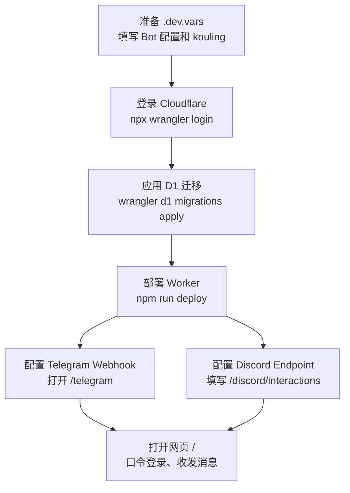

# TriRelay — Telegram ↔ Discord Bridge

TriRelay 是基于 MIT License 开源的 Telegram 与 Discord 双向桥接项目。完整许可条款见 [LICENSE](./LICENSE)。

基于 Cloudflare Workers 和 D1 的双向桥接机器人：Telegram 群组消息、语音、图片和文件自动转发到 Discord；Discord 使用 `/bridge` 斜杠命令发送文字或附件到 Telegram；Telegram 和 Discord 可通过 `/web` 指令向网页收件箱发送消息。

## 安装

需要 Node.js 20+：

```bash
npm install
copy .dev.vars.example .dev.vars
```

填写 `.dev.vars` 中的 `tgbotapi`（Telegram Bot Token）、`dcbotapi`（Discord Bot Token）、Telegram chat id、Discord application id/public key、随机 `BRIDGE_SECRET` 和至少 12 个字符的 `kouling`。网页使用独立口令保护，不会把 Bot Token 暴露给浏览器。配置 `DISCORD_USER_ID` 和 `dcbotapi` 时，Telegram 消息及附件会优先发到该用户的 Discord 私信；私信发送失败时再尝试 `DISCORD_WEBHOOK_URL` 频道 Webhook。

## 网页发送

部署后打开 `https://<WORKER_HOST>/`，首次输入 `kouling` 解锁，登录状态保存在 HttpOnly、安全 Cookie 中，有效期 30 天。可以发送文字或一次选择最多 10 张图片，并勾选 Telegram、Discord 或两个目标。图片支持 JPEG、PNG、GIF 和 WebP，总大小上限由 `MAX_FILE_SIZE_MB` 决定（默认 25 MB）；Telegram 会把 10 MB 以内的多张图片作为相册发送，较大的单张图片会作为文件发送。

网页同时显示通过 `/web` 收到的消息历史，并支持清空整个收件箱；清空操作会删除 D1 数据库中的全部历史记录。若某个发送目标失败，网页会显示该平台返回的错误详情。

登录后点击页面顶部的“注册 Discord 指令”，即可让 Worker 使用服务器端的 Discord Bot Token 注册 `/bridge` 和 `/web`，无需在电脑上运行注册脚本。Bot Token 不会发送到浏览器；请确保 Worker 已配置 `dcbotapi` 和 `DISCORD_APPLICATION_ID` Secret。

页面“平台配置”区域提供快捷入口：点击 Telegram 按钮会在新标签页打开 `/telegram` 并设置 webhook；点击 Discord 按钮可复制当前 Worker 的 `/discord/interactions` 地址，并可跳转到 [Discord Developer Portal](https://discord.com/developers/applications) 创建应用和机器人。

### 网页收件箱指令

- Telegram：在配置的 `TELEGRAM_CHAT_ID` 对话中发送 `/web 要显示的内容`。发送图片时，在图片说明（Caption）中填写 `/web 可选说明`，图片和说明会一起显示在收件箱中；也可以只写 `/web` 并附带图片。
- Discord：使用 `/web` 后选择 `message` 输入文字，或选择 `file` 上传图片；也可以同时填写文字并附上图片。
- 新上传的 Discord 图片不会下载或保存到 D1；D1 只保存 Discord CDN 原始链接、代理链接及文件元数据，网页通过登录保护的 Worker 接口读取图片，并在需要时安全跟随 Discord CDN 重定向。图片可用性依赖 Discord CDN：原消息/附件被删除或 Discord 链接失效后，网页可能无法显示。历史版本已存入 D1 的图片不会自动转换，清空收件箱会删除历史记录。Telegram 图片继续保留在 Telegram，D1 只保存 Telegram 文件 ID。

部署时将网页口令设为 Worker Secret；请在终端按提示输入口令，不要把实际口令写进 README 或提交到 Git：

```bash
npx wrangler secret put kouling
```

本地开发时把口令写入 `.dev.vars`。口令至少 12 个字符，并应使用随机、独立的值；如果口令曾公开分享，请立即更换。

## 部署

收件箱使用 Cloudflare D1 保存消息、元数据和 Discord 图片链接，不保存 Discord 图片二进制。首次部署时先创建数据库：

```bash
npx wrangler login
npx wrangler d1 create telegram-discord-inbox
```

命令会输出数据库 ID。把 ID 填入项目根目录 `wrangler.toml` 的 `database_id`，并确认 binding 为 `DB`。如果本项目已存在 D1 数据库，不要再次创建；保留当前的 `database_id`，直接应用新增迁移。

创建/确认数据库绑定后，应用生产迁移；本地开发数据库也可单独初始化：

```bash
npx wrangler d1 migrations apply telegram-discord-inbox --remote
npx wrangler d1 migrations apply telegram-discord-inbox --local
```

`wrangler.toml` 已配置 D1 binding 和数据库 ID；新增迁移后需重新执行 `migrations apply`。检查生产迁移状态和查看最近收件箱记录：

```bash
npx wrangler d1 migrations list telegram-discord-inbox --remote
npx wrangler d1 execute telegram-discord-inbox --remote --command "SELECT id, source, sender, content, created_at, file_name, file_url FROM web_messages ORDER BY created_at DESC LIMIT 20"
```

导出生产 D1 的 schema 和数据到 SQL 备份文件：

```bash
npx wrangler d1 export telegram-discord-inbox --remote --output=telegram-discord-inbox-backup.sql
```

需要恢复时，先创建/选择一个空的 D1 数据库，再执行：

```bash
npx wrangler d1 execute <DATABASE_NAME> --remote --file=telegram-discord-inbox-backup.sql
```

备份文件包含收件箱消息及 Discord CDN 链接，可能含有私人内容；请妥善保管，不要提交到 Git 或公开分享。导出的是数据库数据，不会把 Discord 图片复制到备份中；图片源仍由 Discord 托管。

### 图形化部署流程



### Cloudflare 控制台图形化操作

1. 登录 Cloudflare 控制台，打开 **Workers & Pages**，选择 `TriRelay`。
2. 进入 **Settings → Variables and Secrets**，添加 Secret：名称填写 `kouling`，值填写网页访问口令，然后保存并部署新版本。不要把口令写入源码或截图分享。
3. 要部署代码更新，可在 **Deployments** 页面查看部署版本；若项目已连接 GitHub，推送代码后等待自动部署。若没有连接 GitHub，请在项目目录运行下方 Wrangler 命令部署。
4. 部署后打开 Worker 域名的 `/telegram`，完成 Telegram webhook 设置；在 Discord Developer Portal 的 **General Information → Interactions Endpoint URL** 填写 `https://<WORKER_HOST>/discord/interactions`。
5. 打开 Worker 域名首页 `/`，输入 `kouling`，发送文字或图片；消息历史会显示在收件箱中。

### 命令行部署步骤

```bash
npx wrangler login
npx wrangler d1 create telegram-discord-inbox
# 将命令返回的 database_id 填入 wrangler.toml；已有数据库请跳过创建步骤
npx wrangler d1 migrations apply telegram-discord-inbox --remote
npx wrangler secret put tgbotapi
npx wrangler secret put dcbotapi
npx wrangler secret put TELEGRAM_CHAT_ID
npx wrangler secret put DISCORD_APPLICATION_ID
npx wrangler secret put DISCORD_PUBLIC_KEY
npx wrangler secret put DISCORD_WEBHOOK_URL
npx wrangler secret put BRIDGE_SECRET
npx wrangler secret put kouling
npm run deploy
```

部署完成后，直接在浏览器打开 `https://<WORKER_HOST>/telegram`，页面显示“Telegram webhook 已配置”即完成 Telegram 部署，不需要手动调用 `setWebhook`。

把 Discord Interactions Endpoint URL 设置为 `https://<WORKER_HOST>/discord/interactions`，然后执行：

```bash
npm run register:discord
```

该命令读取 `.dev.vars` 中的 `dcbotapi` 和 `DISCORD_APPLICATION_ID`，幂等注册 `/bridge` 与 `/web` 指令。`/web message:内容` 写入文字；`/web file:图片` 将 Discord CDN 原始链接、代理链接及元数据保存到 D1，网页通过 Worker 代理预览图片，不把图片二进制保存到 D1。文字和图片也可以一起提交。仅支持 JPEG、PNG、GIF 和 WebP；单张图片大小受 `MAX_FILE_SIZE_MB` 限制。

`/bridge` 命令包含 `message` 文本参数和 `file` 附件参数。执行 `npm run register:discord` 后，Discord 会显示原生文件选择框，可以直接选择文件，不需要粘贴 URL。使用示例：`/bridge message:你好` 或 `/bridge file:<选择文件>`。提交后只会向命令发起者显示“已接收，正在转发到 Telegram。”，不会在回复中回显原消息或附件链接。

## 架构限制

Cloudflare Workers 不能保持 Discord Gateway 长连接，所以本实现不监听 Discord 频道普通消息，而是使用官方 Interactions webhook 接收 `/bridge`。若必须同步 Discord 普通消息，需要额外运行 Gateway 进程，再调用此 Worker。